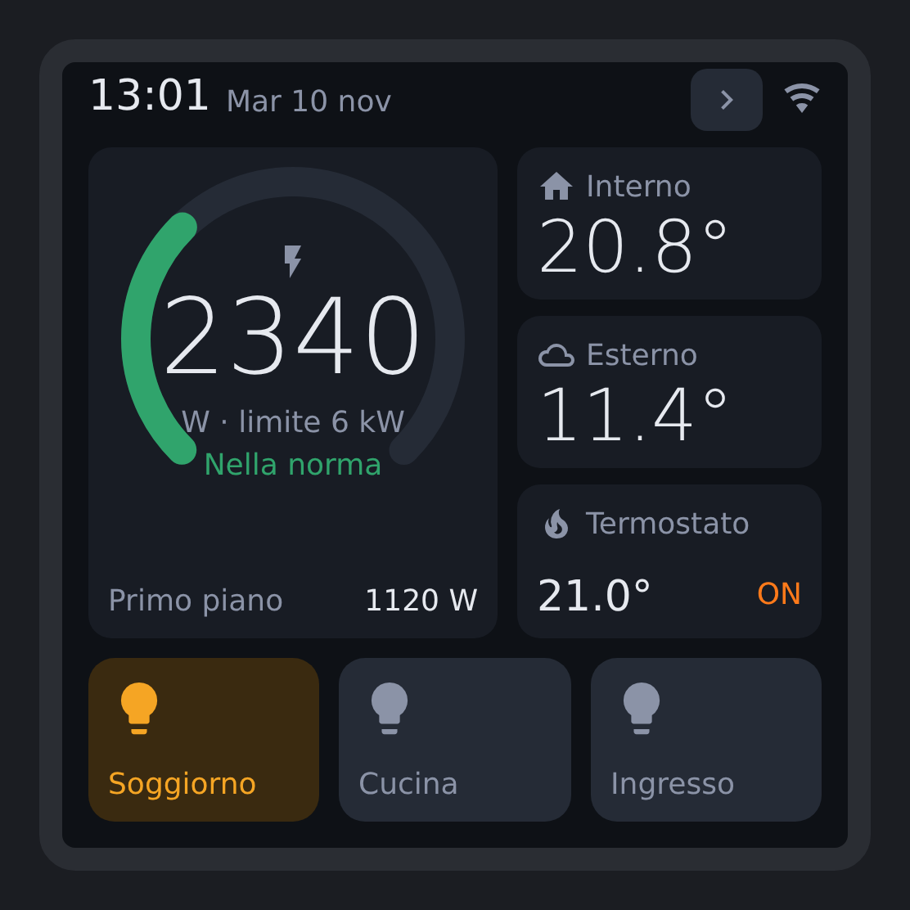

# ESPHome HA Panel — Guition ESP32-S3-4848S040

Pannello touch 4" 480×480 per Home Assistant, basato su ESPHome + LVGL.
Niente blueprint, niente file TFT: tutta la logica sta nello YAML.

<p align="center"></p>

<sub>Anteprima indicativa del layout (mockup), non uno screenshot del dispositivo.</sub>

**Pagina Casa**
- Consumo istantaneo su arco con soglie colorate (verde / arancio / rosso) e consumo secondario
- Temperatura interna ed esterna
- Termostato: setpoint e stato; un tocco alterna `heat` / `off`
- 3 tasti on/off (luci o qualsiasi entità `light.*` / `switch.*`) che seguono lo stato reale

**Pagina Stanze**
- 4 temperature grandi

Il tasto `>` nella barra in alto cambia pagina. Dopo un periodo di inattività (regolabile da HA, disattivabile con lo switch **Dimming automatico**)
la luminosità si abbassa; il tocco la riporta piena.

## Hardware

| | |
|---|---|
| Scheda | Guition ESP32-S3-4848S040 (con o senza modulo 3 relè) |
| Display | ST7701S 480×480 RGB |
| Touch | GT911 |
| MCU | ESP32-S3, 16 MB flash, 8 MB PSRAM |

Pinout dalla [pagina ufficiale ESPHome devices](https://devices.esphome.io/devices/Guition-ESP32-S3-4848S040).
Il GT911 di questa scheda dichiara 1024×600 ma invia coordinate 0..480: il file hardware
imposta una `calibration` esplicita, altrimenti i tocchi finiscono spostati in alto a sinistra.
Tutto l'hardware è isolato in `packages/hardware/`: per un'altra scheda basta
un file che esponga `tft_display`, `tft_touch` e `display_backlight`.

## Struttura

```
packages/
  hardware/guition-4848s040.yaml         display, touch, retroilluminazione
  hardware/guition-4848s040-relays.yaml  opzionale, modulo relè
  base.yaml                              wifi, api, ota, orario
  ha_data.yaml                           entità HA (segnaposto via substitutions)
  ui.yaml                                interfaccia LVGL
ha-panel.example.yaml                    esempio di deploy
secrets.example.yaml
```

## Installazione

1. Copia `ha-panel.example.yaml` nella tua cartella ESPHome.
2. Imposta le substitutions con le tue entità (vedi tabella sotto).
3. Aggiungi le chiavi di `secrets.example.yaml` al tuo `secrets.yaml`.
4. Primo flash via USB, poi OTA.
5. In Home Assistant: **Impostazioni → Dispositivi e servizi → ESPHome → Configura**
   sul pannello e abilita **"Consenti al dispositivo di eseguire azioni Home Assistant"**,
   altrimenti luci e termostato non rispondono al tocco.

## Substitutions

| Chiave | Default | Note |
|---|---|---|
| `ent_power_total` | `sensor.power_total` | W |
| `ent_power_sub` / `label_power_sub` | `sensor.power_sub` / `Primo piano` | consumo secondario |
| `power_warn` / `power_limit` | `4500` / `6000` | soglie colore in W |
| `power_limit_label` | `6 kW` | testo sotto i watt |
| `power_max_scale` | `7000` | fondo scala arco |
| `ent_temp_in` / `ent_temp_out` | — | sensori °C |
| `ent_climate` | `climate.thermostat` | usa attributi `temperature` e `hvac_action` |
| `ent_light_N` / `label_light_N` | — | N = 1..3 |
| `ent_room_N` / `label_room_N` | — | N = 1..4 |
| `display_rotation` | `0` | `270` con USB verso il basso |
| `idle_timeout` | `60` | secondi, valore iniziale; poi si regola da HA con **Timeout dimming** |
| `brightness_active` | `100%` | luminosità al tocco |
| `brightness_idle` | `15` | %, valore iniziale; poi si regola da HA con **Luminosità a riposo** |
| `log_level` / `lvgl_log_level` | `INFO` / `WARN` | `DEBUG` / `INFO` per diagnosticare il touch |

**Temperatura esterna da un'entità `weather`**: crea un template sensor in HA
(`{{ state_attr('weather.casa', 'temperature') }}`) e usalo come `ent_temp_out`.

## Limiti noti / TODO

- Testato su hardware reale (v0.1.0).

- Il tocco che riaccende lo schermo attiva anche il widget sotto il dito.
- Nessuna regolazione di luminosità per le luci (in programma: pressione lunga).
- Swipe tra le pagine non ancora implementato (c'è il tasto `>`).

## Licenza

MIT
